<div align="center">

# SAR Run Viewer

**Watch Portal 2 speedruns in your browser: the route on a map, or the whole
run replayed in 3D inside the real level.**


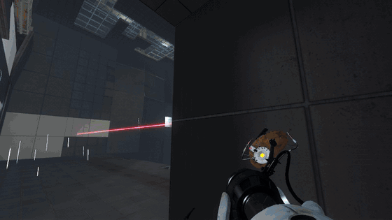

*A recording from sp_a4_laser_platform, replayed in the viewer.*

</div>

---

Drop in a SAR proof (`.sarp`) or a run's demos (`.dem`) and watch it. You can
see the route on a map with every input, split and console command, or replay
it from the runner's eyes inside the actual map. The 3D view reads the map,
models and textures from your own copy of Portal 2 and draws them the way the
game does: lightmaps, portals, lasers, funnels, gel and particle effects.

Everything happens in the page. Recordings and game files never leave your
computer.

## Gallery

<table>
<tr>
<td width="50%">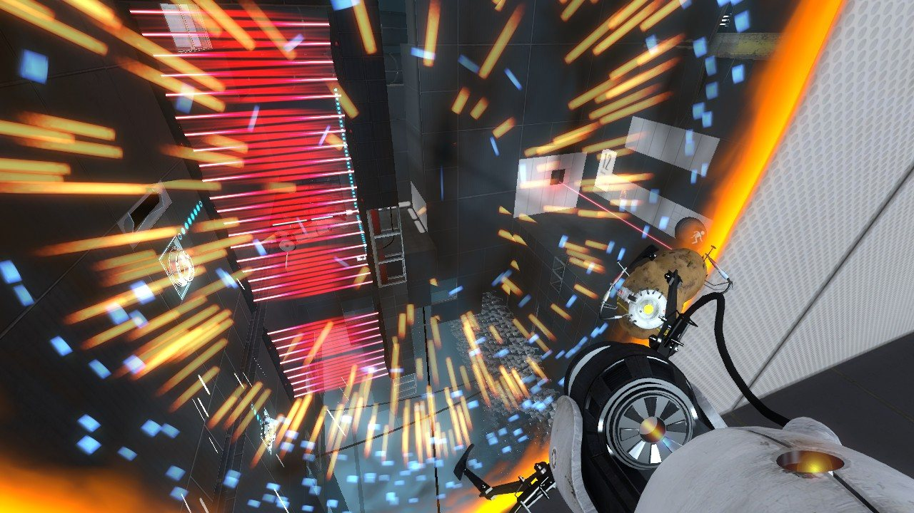<br><sub><b>Portals:</b> the live view through each one, the opening animation, edge flames and placement sparks.</sub></td>
<td width="50%">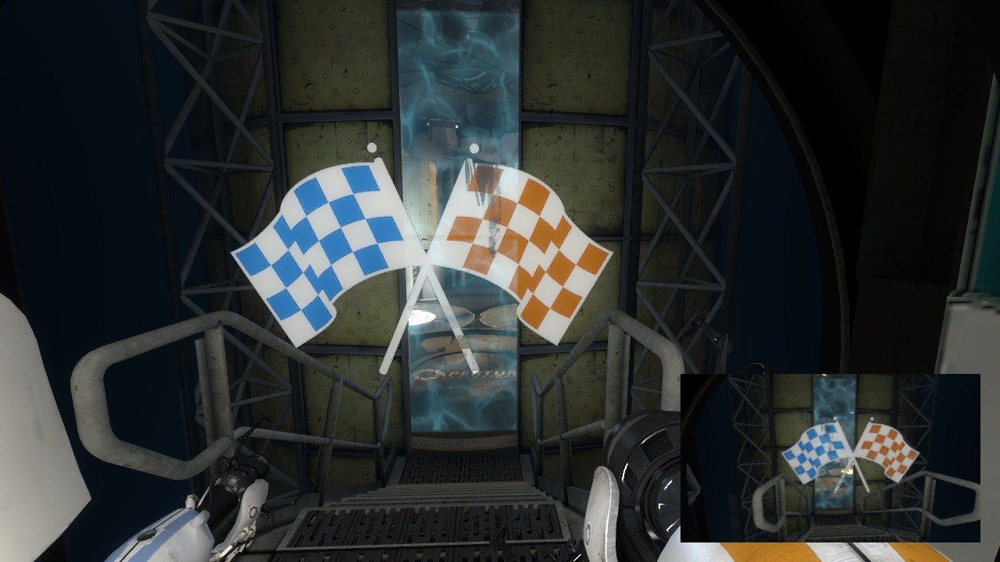<br><sub><b>Co-op:</b> both robots, with the partner's view in the corner as autorender's co-op renders show it.</sub></td>
</tr>
<tr>
<td>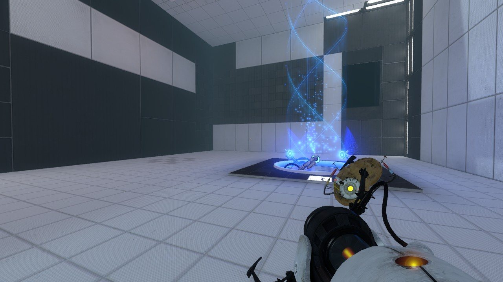<br><sub><b>Excursion funnels:</b> drawn with the game's own flowing materials.</sub></td>
<td>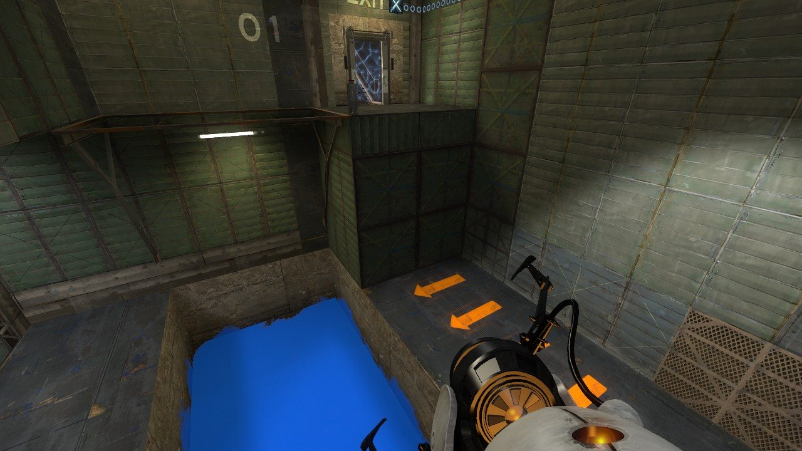<br><sub><b>Gel:</b> painted from the recording's paint data, aligned to the map's lightmaps.</sub></td>
</tr>
<tr>
<td>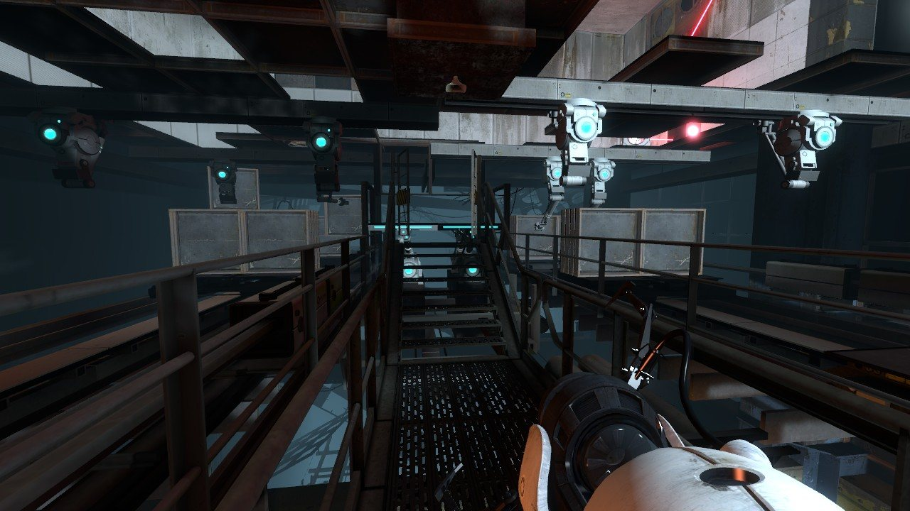<br><sub><b>Lasers and turrets:</b> beams, aim lasers and glows from their networked state.</sub></td>
<td>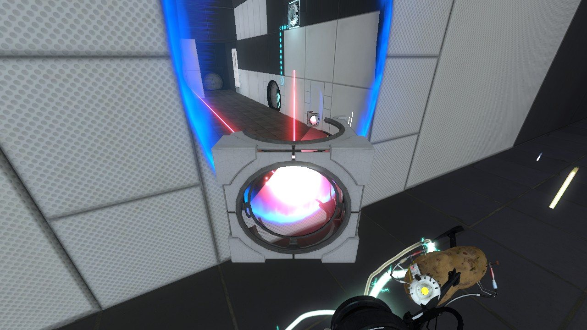<br><sub><b>Laser catchers and relays:</b> glowing as they're hit, with the gun's hold beam and PotatOS.</sub></td>
</tr>
<tr>
<td>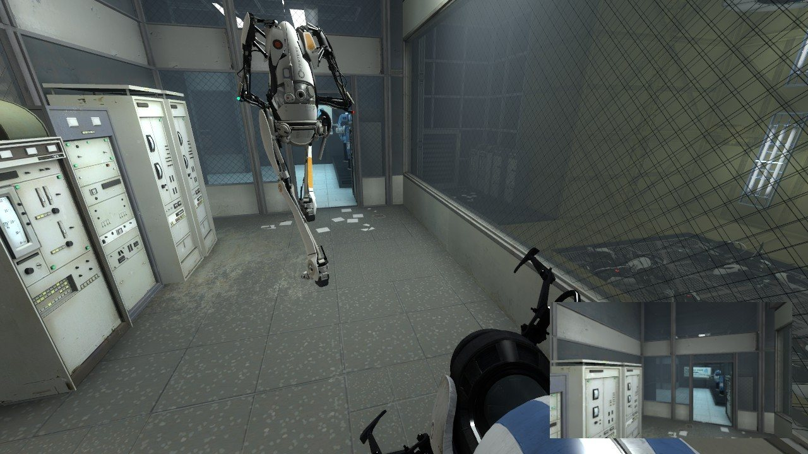<br><sub><b>Animated players:</b> Chell, Atlas and P-body move as recorded: running, jumping, flinging, aiming.</sub></td>
<td>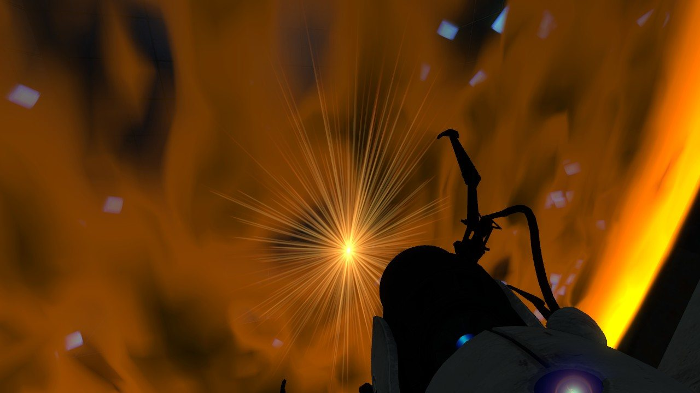<br><sub><b>Anywhere in the game:</b> every single-player and co-op map, including the finale and space.</sub></td>
</tr>
</table>

## Two ways to watch

<table>
<tr>
<td width="50%">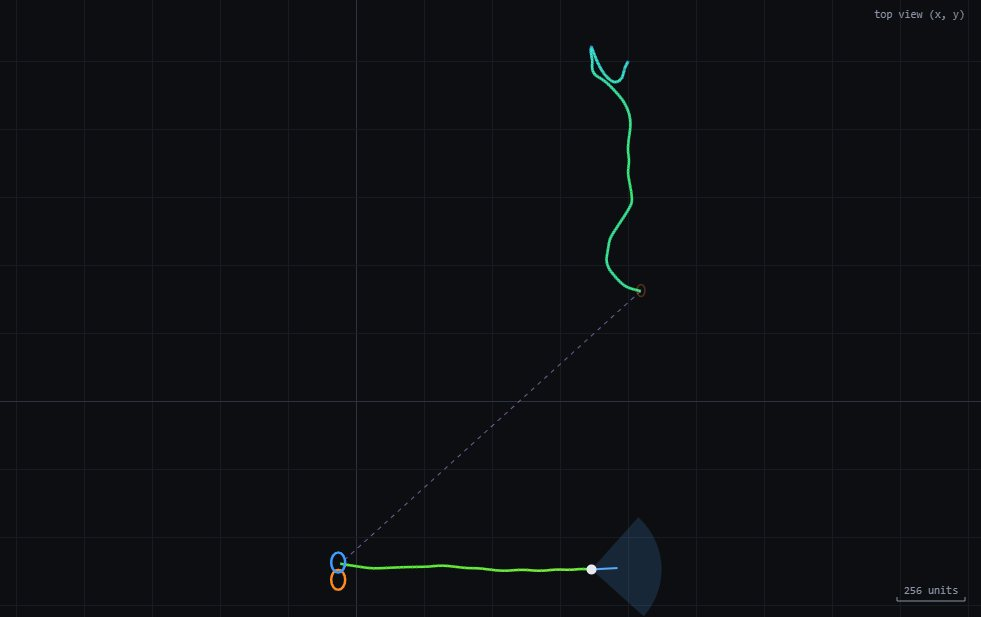</td>
<td width="50%">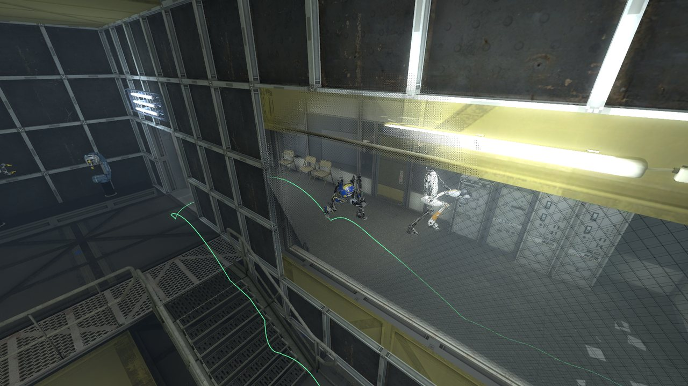</td>
</tr>
<tr>
<td><b>On the map (Top / Side).</b> The route coloured by speed, portal placements, teleports, the view cone, inputs and a speed graph. It works without the game installed.</td>
<td><b>In 3D (Eyes / Orbit / Free).</b> Through the runner's eyes, orbiting them, or flying freely. Walls between the camera and the player dissolve so you never lose sight of them.</td>
</tr>
</table>

## Features

**Reading runs**
- SAR proofs (`.sarp`), with the hash chain, signature and whether the
  recording stopped cleanly.
- Demos (`.dem`). Open all of a run's demos at once and they play as one run.
- Single-player and co-op, from either player's recording.

**On the map**
- The path coloured by speed, with portal teleports dashed.
- The view direction, plus inputs from the recorded user commands (WASD,
  jump, duck, both fire buttons).
- A speed graph across the segment.
- Events, console commands, SAR's timer splits and category rules.

**In 3D**
- The world straight from the BSP:
  - brushes, displacements and overlays,
  - brush entities such as doors, elevators and panels,
  - baked HDR lightmaps and switchable lights,
  - fog, and the 2D and 3D skyboxes.
- The game's shaders reproduced: LightmappedGeneric, VertexLitGeneric with
  phong and rim lighting, cubemap reflections, Refract, decals, $selfillum,
  detail textures.
- Every entity from the recording's network data, interpolated between
  updates the way the game's client does: props, cubes, turrets, buttons,
  doors.
- Players animated from their recorded movement, holding the portal gun, and
  the view-model gun in first person.
- Portals with the live view through their partner.
- Gameplay elements:
  - lasers, light bridges, excursion funnels and fizzlers,
  - gel,
  - Bink video screens and chamber signs.
- The game's particle systems (PCF) simulated in the browser: the hold beam,
  sparks, steam, glows, ropes.
- The screen as the game shows it:
  - auto exposure matching the game's tonemap controller,
  - bloom,
  - the challenge-mode HUD and chapter titles,
  - the co-op partner's view.

**Fast**
- **Background loading:** the 3D view loads in the background as soon as a
  segment is on screen, so switching to 3D is close to instant.
- **First-watch preload:** once a segment is loaded, every model, texture,
  particle effect and shader it needs is prepared ahead, so the first watch
  doesn't stutter.
- **Smooth client recordings:** co-op client recordings (usually P-body's)
  play smoothly. Their snapshots arrive only every few ticks, unevenly
  spaced, and the viewer smooths between them.

## Quick start

Needs Node 22 or newer, and Chrome or Edge for the 3D view.

```bash
npm install
```

```bash
npm run dev
```

Open http://localhost:5173, drop a `.sarp` or `.dem` on the page, and press
**3D**. The first time, pick your `Portal 2` folder: the one with
`portal2.exe`, usually under `steamapps/common`.

<details>
<summary><b>Development conveniences</b></summary>

- **No folder picking.** In dev, the server serves your Portal 2 install at
  `/__game/`, so the 3D view works after each reload without picking the
  folder. It defaults to the Steam path; point it elsewhere with `P2_DIR`:

  ```bash
  P2_DIR="D:/Games/Portal 2" npm run dev
  ```

- **Open a file from the address bar.** `#load=fixtures/<file>` opens a
  file from `fixtures/`, for example
  `http://localhost:5173/#load=fixtures/run.dem`.
- **`fixtures/` is git-ignored.** Keep test recordings there. They're the
  players' own runs, so they stay out of the repository.

| Command | What it does |
|---|---|
| `npm run dev` | Dev server with hot reload |
| `npm run build` | Typecheck and build a static site into `dist/` |
| `npm run check` | Typecheck only |
| `npm run probe -- <files>` | Print what the readers get from a `.sarp` or `.dem` |

</details>

## Controls

| | |
|---|---|
| <kbd>Space</kbd> | Play / pause |
| <kbd>←</kbd> <kbd>→</kbd> | Step one tick |
| <kbd>Shift</kbd> + <kbd>←</kbd> <kbd>→</kbd> | Step one second |
| <kbd>Home</kbd> | Back to the start of the segment |
| **Orbit** | Drag to turn, scroll to zoom in or out as far as you like |
| **Free** | Drag to look, <kbd>W</kbd><kbd>A</kbd><kbd>S</kbd><kbd>D</kbd> to move, <kbd>Q</kbd>/<kbd>E</kbd> down/up, <kbd>Shift</kbd> faster, <kbd>Ctrl</kbd> slower |

These toggles in the 3D view are remembered per browser:

| Toggle | What it does |
|---|---|
| **Path** | The route drawn through the map. |
| **Timer** | The challenge-mode HUD (portals and time), from the recording's own stats. |
| **Titles** | The game's on-screen text, such as chapter titles. |
| **Partner** | The co-op partner's view in the corner. |
| **Bright** | Brightens dark maps the way autorender does. |

## Made to match the game

The aim is that a frame in the viewer looks like the same frame in Portal 2.
Behaviour is taken from the shipped game's code, and checked against frames
of the real game rendered from the same recordings.

Comparison sheets put the game, the viewer before a change and the viewer
after side by side, and score which is closer. The code comments name the
engine function each piece follows.

**How a 3D frame is made:**

1. Read every entity's state at the current tick, then place, animate and
   light it.
2. Draw each portal's view: a whole scene seen through its partner.
3. Draw the world into an HDR frame.
4. Expose it like the game's tonemap controller and add bloom.
5. Draw the view-model gun and first-person effects on top.

<details>
<summary><b>Project layout</b></summary>

```
src/
  core/    file readers: .dem and .sarp into one format-independent Run
  net/     network data: data tables, string tables, packet entities,
           proofs' entity records → per-entity timelines; paint messages
  game/    the game's files: VPK, BSP (lightmaps, vis, ambient light), VMT/VTF,
           MDL/VVD/VTX models and animation, PCF particle systems, Bink
  player/  a run turned into one timeline across its segments
  ui/      drawing: the 2D path view, charts and panels, and the 3D view
           (view3d.ts) with its shader hooks, particles, effects and paint
tools/     command-line probes and comparison scripts
docs/      images for this README
```

TypeScript, [three.js](https://threejs.org) for rendering and
[three-mesh-bvh](https://github.com/gkjohnson/three-mesh-bvh) for ray casts.
There's no UI framework; the UI is plain DOM.

</details>

<details>
<summary><b>Development tools</b></summary>

Probes, run with `node --experimental-strip-types tools/<name>.ts`:

| Tool | What it prints |
|---|---|
| `probe.ts` | What the readers get from a recording |
| `entprobe.ts` | Entity decode summary |
| `bspprobe.ts <map>` | A map's materials and static props |
| `pcfprobe.ts <system>` | A particle system's full definition |
| `matinfo.ts`, `mdlinfo.ts` | A material or model as the viewer reads it |
| `texprofile.ts` | A texture's brightness profile |

Comparing against the game (Python, with Pillow, numpy and ffmpeg):

| Tool | What it does |
|---|---|
| `shotdiff.py <before> <after> <out>` | Which shots a change moved, scored before and after against the game's frame |
| `boardcmp.py` | The viewer next to autorender's renders of the same runs |
| `refshots.py` | Reference frames from the real game |
| `refcompare.py` | Viewer shots against those frames |

In dev, the page has hooks on `window`:

| Hook | What it does |
|---|---|
| `shootAt(path, tick, name)` | Open a file, wait for loading at a tick, save a shot to `fixtures/shots/` |
| `record(name, from, to)` | Frames of a tick range, for clips |
| `bench(tick)` | Load time and frame cost |
| `prof(tick)` | Frame cost by stage |
| `timings` | How long each loading step took |

</details>

## Limitations

- **Browser:** the 3D view needs Chrome or Edge, because it reads the game
  folder through the File System Access API. The map views work in any modern
  browser.
- **Maps:** the 3D view finds maps in the game's own map folders. A map that
  isn't there (a mod's, or a workshop map you haven't downloaded) can't be
  shown.
- **Not every effect is matched yet.** Some particle systems and shaders are
  close approximations. Where the viewer and the game differ, the game is
  right.

<div align="center"><sub>Portal 2 and its content belong to Valve. Nothing from the game is included here: the viewer reads your own install.</sub></div>
