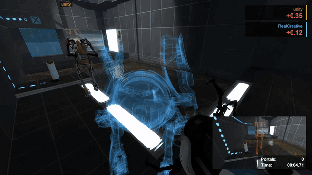

<div align="center">

# SAR Run Viewer

**Watch Portal 2 speedruns in your browser: the route on a map, or the whole
run replayed in 3D inside the real level.**


*A recording from sp_a4_laser_platform, replayed in the viewer.*

</div>

---

Drop in a SAR proof (`.sarp`) or a run's demos (`.dem`) and watch it. You can
see the route on a map with every input, split and console command, or replay
it from the runner's eyes inside the actual map. The 3D view reads the map,
models and textures from your own copy of Portal 2 and draws them the way the
game does: lightmaps, portals, lasers, funnels, gel and particle effects.

Everything happens in the page. Recordings and game files never leave your
computer.

## Gallery

<table>
<tr>
<td width="50%"><br><sub><b>Portals:</b> the live view through each one, the opening animation, edge flames and placement sparks.</sub></td>
<td width="50%"><br><sub><b>Co-op:</b> both robots, with the partner's view in the corner as autorender's co-op renders show it.</sub></td>
</tr>
<tr>
<td><br><sub><b>Excursion funnels:</b> drawn with the game's own flowing materials.</sub></td>
<td><br><sub><b>Gel:</b> painted from the recording's paint data, aligned to the map's lightmaps.</sub></td>
</tr>
<tr>
<td><br><sub><b>Lasers and turrets:</b> beams, aim lasers and glows from their networked state.</sub></td>
<td><br><sub><b>Laser catchers and relays:</b> glowing as they're hit, with the gun's hold beam and PotatOS.</sub></td>
</tr>
<tr>
<td><br><sub><b>Animated players:</b> Chell, Atlas and P-body move as recorded: running, jumping, flinging, aiming.</sub></td>
<td><br><sub><b>Anywhere in the game:</b> every single-player and co-op map, including the finale and space.</sub></td>
</tr>
<tr>
<td colspan="2" align="center"><br><sub><b>Co-op race:</b> Bexc & hero's 17.56 on Buttons, raced against RealCreative & unity's 17.60. The other run's players are glowing copies of their robots, each compared with the player doing the same job, with the partner's view in the corner.</sub></td>
</tr>
</table>

## Two ways to watch

<table>
<tr>
<td width="50%"></td>
<td width="50%"></td>
</tr>
<tr>
<td><b>On the map (Top / Side).</b> The route coloured by speed, portal placements, teleports, the view cone, inputs and a speed graph. It works without the game installed.</td>
<td><b>In 3D (Eyes / Orbit / Chase / Free).</b> Through the runner's eyes, orbiting them, following behind them, or flying freely. Walls between the camera and the player dissolve so you never lose sight of them.</td>
</tr>
</table>

## Features

**Reading runs**
- SAR proofs (`.sarp`), with the hash chain, signature and whether the
  recording stopped cleanly.
- Demos (`.dem`). Open all of a run's demos at once and they play as one run.
- Single-player and co-op, from either player's recording.

**On the map**
- The path coloured by speed, with portal teleports dashed.
- The view direction, plus inputs from the recorded user commands (WASD,
  jump, duck, both fire buttons).
- A speed graph across the segment, with its tricks marked along the top:
  bunny hops (chains counted), flings out of portals, portal placements and
  speed peaks, found from the recording. Click near one to jump to it; they're
  listed among the events too.
- With runs raced, a **Gap** graph instead: how far ahead or behind each one is
  over the segment, a line in its colour.
- An **Inputs** graph: the keys this run held, tick by tick, over the
  seconds around now, beside those of the split screen's run (or the first
  shown raced run), lined up as the race lines them up.
- **Trail** and **Shots** (in 3D too): where the player was over the last
  moment, fading, and a line from the player to each portal as it's placed.
- **Heat:** with runs raced, a heatmap of where they all went, brighter where
  more of them did, so the usual route and the rare ones stand out.
- **Swarm:** a board's top 100 runs as dots moving through the map with the
  run shown, gold at the top to blue at the back (from the leaderboard's
  **Swarm top 100**; light enough to cost a fraction of a millisecond a frame).
- **Map image:** a picture of the map's routes from above (or the side) to
  save: where the raced and swarm runs went as a glow, each route's fastest
  run in its colour, named where it leaves the main route, this run bold over
  them with its tricks marked.
- Events, console commands, SAR's timer splits and category rules.

**In 3D**
- The world straight from the BSP:
  - brushes, displacements and overlays,
  - brush entities such as doors, elevators and panels,
  - baked HDR lightmaps and switchable lights,
  - fog, and the 2D and 3D skyboxes.
- The game's shaders reproduced: LightmappedGeneric, VertexLitGeneric with
  phong and rim lighting, cubemap reflections, Refract, decals, $selfillum,
  detail textures.
- Every entity from the recording's network data, interpolated between
  updates the way the game's client does: props, cubes, turrets, buttons,
  doors.
- Players animated from their recorded movement, holding the portal gun, and
  the view-model gun in first person.
- Portals with the live view through their partner.
- Gameplay elements:
  - lasers, light bridges, excursion funnels and fizzlers,
  - gel,
  - Bink video screens and chamber signs.
- The game's particle systems (PCF) simulated in the browser: the hold beam,
  sparks, steam, glows, ropes.
- The screen as the game shows it:
  - auto exposure matching the game's tonemap controller,
  - bloom,
  - the challenge-mode HUD and chapter titles,
  - the co-op partner's view.

**Fast**
- **Background loading:** the 3D view loads in the background as soon as a
  segment is on screen, so switching to 3D is close to instant.
- **First-watch preload:** once a segment is loaded, every model, texture,
  particle effect and shader it needs is prepared ahead, so the first watch
  doesn't stutter.
- **Smooth client recordings:** co-op client recordings (usually P-body's)
  play smoothly. Their snapshots arrive only every few ticks, unevenly
  spaced, and the viewer smooths between them.
- **Off the page's thread:** maps and models are parsed in workers, and the
  next level of a multi-map run is loaded while the current one plays, so
  level changes don't stop.
- **Remembered between visits:** the game folder's file listings are kept in
  the browser, so opening the viewer again is quicker.
- **Quality setting:** High, Medium or Low (resolution, antialiasing, bloom
  and shadow detail) for slower machines.

**Share and compare**
- **Ghost race:** load other runs of the same map, as many as you like. Each
  one's player is drawn in its own colour beside yours (in 3D a glowing copy
  of their own robot or Chell, animated as their demo recorded them; a marker
  in the Top and Side views), with a live readout of how far
  ahead or behind you are, measured where it passed the same spot. Runs are
  lined up from where each one's timer started, and in co-op each player is
  compared with the one doing the same job. Each can be hidden, have its path
  drawn through the map, or be taken off again, and exported videos show the
  readout too. Pick a whole board's top runs at once: each file becomes its
  own run, and a co-op run's two demos (as the board names them) share one
  colour and one row. Demos from before the challenge-mode finish was recorded
  are lined up by where their player reaches the finish. Click a run's row to
  show or hide it, Ctrl-click it to show only that one (again for all), or use
  **All**, **None** and **Paths** at the top of the list. **Watch** on a run's
  row swaps it with the one shown, at the same moment of the race: you see it
  through its player's eyes (its portals, objects and partner view too), and
  the run you were watching races as a ghost in its place. **Split** on a
  row plays that run's own demo beside this one, split screen, in step with
  it: each half has its own portals, objects, inputs, speed and timer as its
  demo recorded them.
- **Race tab:** the raced runs section by section. Sections end where every
  run passes near the same spot on this run's route; each run's time there
  is when it last came by before going on. The best of each section is
  marked, with their sum (among the runs on this run's route). The routes the
  runs took are grouped too (a run that goes another way for part of it is
  another route), and a route's button shows just its runs, in the views and
  the heatmap.
- **Leaderboard:** browse any chamber's runs on
  [board.portal2.sr](https://board.portal2.sr), best first, and open one or
  race the top 5, 10 or 20 (or the ones ticked) against the run shown, or
  **Race WR history**: every world record the chamber has had (those with
  demos), each named with when it was set. Their
  demos downloaded straight into the page. A co-op run comes with both
  players' demos, the partner's found beside it where the board lists them
  at another run. Downloaded demos are kept in the browser (the latest 300),
  so racing them again is instant, and **Link** links the run, its partner,
  the raced runs and the split screen by their board ids. The dev server
  passes the board's demos through, as the board doesn't serve them to other
  sites.
- **Guess the time:** a game. A random top-50 run of a random chamber opens
  with everything that would tell its time or whose it is hidden (the clock,
  the challenge mode timer, names, the file and the panels); watch it as you
  like, then guess its whole time. Five rounds, up to 1000 points each (none
  at 20% off), your best game remembered.
- **Video export:** save any segment, or the whole run, as an MP4 (720p to
  1440p, 30 or 60 fps). Frames are drawn one by one, so nothing is dropped, and
  the challenge-mode HUD and chapter titles are included. Encoding uses the
  browser's own H.264 encoder (WebCodecs), and nothing is uploaded.
- **Links to a moment:** the **Link** button copies a URL with the tick, the
  view and the 3D camera. When the run was opened from a URL, the link opens
  it directly. Otherwise it names the file, and whoever opens the link drops
  that file in to jump to the same moment.

## Quick start

Needs Node 22 or newer, and Chrome or Edge for the 3D view.

```bash
npm install
```

```bash
npm run dev
```

Open http://localhost:5173, drop a `.sarp` or `.dem` on the page, and press
**3D**. The first time, pick your `Portal 2` folder: the one with
`portal2.exe`, usually under `steamapps/common`.

<details>
<summary><b>Development conveniences</b></summary>

- **No folder picking.** In dev, the server serves your Portal 2 install at
  `/__game/`, so the 3D view works after each reload without picking the
  folder. It defaults to the Steam path; point it elsewhere with `P2_DIR`:

  ```bash
  P2_DIR="D:/Games/Portal 2" npm run dev
  ```

- **Open a file from the address bar.** `#load=fixtures/<file>` opens a
  file from `fixtures/`, for example
  `http://localhost:5173/#load=fixtures/run.dem`.
- **`fixtures/` is git-ignored.** Keep test recordings there. They're the
  players' own runs, so they stay out of the repository.

| Command | What it does |
|---|---|
| `npm run dev` | Dev server with hot reload |
| `npm run build` | Typecheck and build a static site into `dist/` |
| `npm run check` | Typecheck only |
| `npm test` | The tests (`tests/`): race lining up, tricks, the leaderboard's runs, links and the view between views, on small made-up runs |
| `npm run probe -- <files>` | Print what the readers get from a `.sarp` or `.dem` |

</details>

### Hosting

`npm run build` makes a static site in `dist/` for any static host (Cloudflare
Pages, GitHub Pages, Netlify). Nothing from the game is hosted: each viewer
picks their own Portal 2 folder, and the browser remembers it, so later
visits only ask to allow it again.

The leaderboard's demos need a pass-through, as the board doesn't serve them
to other sites: `deploy/board-proxy` is a Cloudflare Worker that does it
(scores and demos only, demos cached). Deploy it with `wrangler deploy` in
that folder, then build the viewer with its address:

```bash
VITE_BOARD_PROXY=https://sar-viewer-board.<you>.workers.dev npm run build
```

## Controls

| | |
|---|---|
| <kbd>Space</kbd> | Play / pause |
| <kbd>←</kbd> <kbd>→</kbd> | Step one tick (or the **−1t** / **+1t** buttons, which also pause) |
| <kbd>Shift</kbd> + <kbd>←</kbd> <kbd>→</kbd> | Step one second (or **−1s** / **+1s**) |
| <kbd>Home</kbd> | Back to the start of the segment |
| **Close** | Closes the run and the runs raced against it, and frees the loaded map, back to the start page |
| **Orbit** | Drag to turn, scroll to zoom in or out as far as you like |
| **Chase** | Follows behind the player along where they look, closer where a wall is in the way |
| **Free** | Drag to look, <kbd>W</kbd><kbd>A</kbd><kbd>S</kbd><kbd>D</kbd> to move, <kbd>Q</kbd>/<kbd>E</kbd> down/up, <kbd>Shift</kbd> faster, <kbd>Ctrl</kbd> slower |

While you drag to turn in **Orbit** or **Free**, the pointer is locked to the view (hidden, as in a game), so it can't run off onto another screen; let go of the button, or press <kbd>Esc</kbd>, to get it back.

These toggles in the 3D view are remembered per browser:

| Toggle | What it does |
|---|---|
| **Path** | The route drawn through the map. |
| **Timer** | The challenge-mode HUD (portals and time), from the recording's own stats. |
| **Titles** | The game's on-screen text, such as chapter titles. |
| **Names** | Each player's name over their head (raced runs' in their colour), drawn into exported videos too. |
| **Partner** | The co-op partner's view in the corner. |
| **Split** | Split screen in Eyes view: the co-op partner beside this player, or a raced run (picked with its row's **Split**), each half labelled with its player. Where the partner's own demo is loaded too (pick it with **Ghost**), the right half plays it: their own view, lined up by where both demos have the partner. Without it, the partner is seen through this demo's network data. Exports include both halves. |
| **Bright** | Brightens dark maps the way autorender does. |
| **Quality** | High, Medium or Low: resolution, antialiasing, bloom, shadow detail, and in co-op how often the partner's view is redrawn (every frame, every 2nd, every 3rd). |

The toolbar also has **Ghost** (race other runs of the map), and in 3D
**Export** (save an MP4). The **Link** button next to the clock copies a link
to the current moment.

## Made to match the game

The aim is that a frame in the viewer looks like the same frame in Portal 2.
Behaviour is taken from the shipped game's code, and checked against frames
of the real game rendered from the same recordings.

Comparison sheets put the game, the viewer before a change and the viewer
after side by side, and score which is closer. The code comments name the
engine function each piece follows.

**How a 3D frame is made:**

1. Read every entity's state at the current tick, then place, animate and
   light it.
2. Draw each portal's view: a whole scene seen through its partner.
3. Draw the world into an HDR frame.
4. Expose it like the game's tonemap controller and add bloom.
5. Draw the view-model gun and first-person effects on top.

<details>
<summary><b>Project layout</b></summary>

```
src/
  core/    file readers: .dem and .sarp into one format-independent Run
  net/     network data: data tables, string tables, packet entities,
           proofs' entity records → per-entity timelines; paint messages
  game/    the game's files: VPK, BSP (lightmaps, vis, ambient light), VMT/VTF,
           MDL/VVD/VTX models and animation, PCF particle systems, Bink
  player/  a run turned into one timeline across its segments
  ui/      drawing: the 2D path view, charts and panels, and the 3D view
           (view3d.ts) with its shader hooks, particles, effects and paint
tools/     command-line probes and comparison scripts
docs/      images for this README
```

TypeScript, [three.js](https://threejs.org) for rendering and
[three-mesh-bvh](https://github.com/gkjohnson/three-mesh-bvh) for ray casts.
There's no UI framework; the UI is plain DOM.

</details>

<details>
<summary><b>Development tools</b></summary>

Probes, run with `node --experimental-strip-types tools/<name>.ts`:

| Tool | What it prints |
|---|---|
| `probe.ts` | What the readers get from a recording |
| `entprobe.ts` | Entity decode summary |
| `bspprobe.ts <map>` | A map's materials and static props |
| `pcfprobe.ts <system>` | A particle system's full definition |
| `matinfo.ts`, `mdlinfo.ts` | A material or model as the viewer reads it |
| `texprofile.ts` | A texture's brightness profile |

Comparing against the game (Python, with Pillow, numpy and ffmpeg):

| Tool | What it does |
|---|---|
| `shotdiff.py <before> <after> <out>` | Which shots a change moved, scored before and after against the game's frame |
| `boardcmp.py` | The viewer next to autorender's renders of the same runs |
| `refshots.py` | Reference frames from the real game |
| `refcompare.py` | Viewer shots against those frames |

In dev, the page has hooks on `window`:

| Hook | What it does |
|---|---|
| `shootAt(path, tick, name)` | Open a file, wait for loading at a tick, save a shot to `fixtures/shots/` |
| `record(name, from, to)` | Frames of a tick range, for clips |
| `bench(tick)` | Load time and frame cost |
| `prof(tick)` | Frame cost by stage |
| `timings` | How long each loading step took |

</details>

## Limitations

- **Browser:** the 3D view needs Chrome or Edge, because it reads the game
  folder through the File System Access API. The map views work in any modern
  browser.
- **Maps:** the 3D view finds maps in the game's own map folders. A map that
  isn't there (a mod's, or a workshop map you haven't downloaded) can't be
  shown.
- **Not every effect is matched yet.** Some particle systems and shaders are
  close approximations. Where the viewer and the game differ, the game is
  right.

<div align="center"><sub>Portal 2 and its content belong to Valve. Nothing from the game is included here: the viewer reads your own install.</sub></div>
